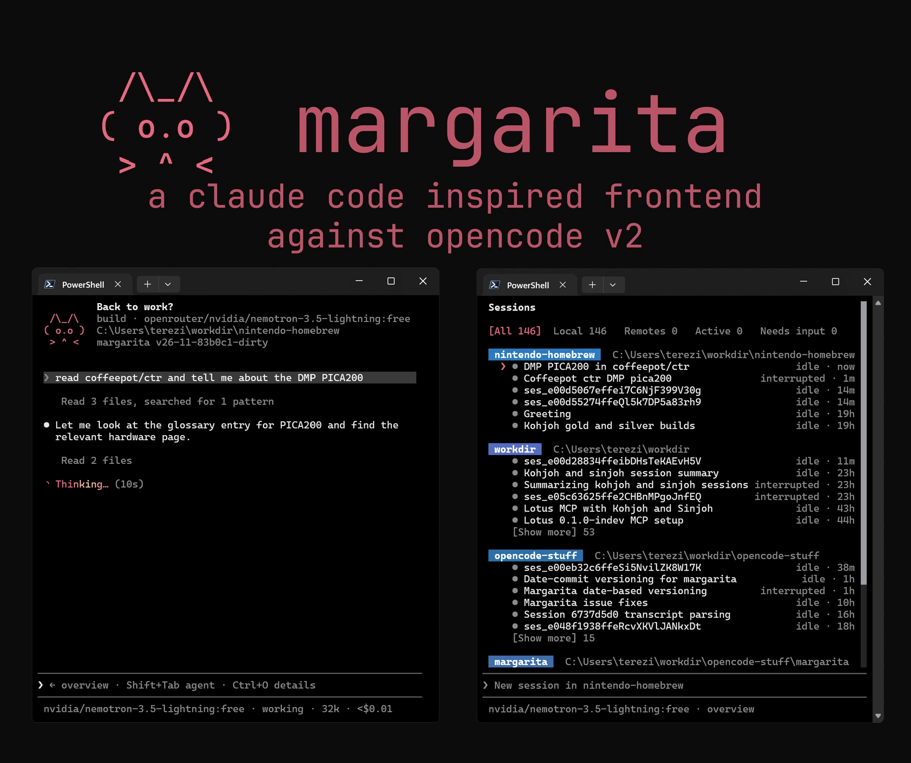

**margarita** (`marg`) is a terminal frontend for the [OpenCode](https://opencode.ai) v2 server. it makes opencode feel more like claude or codex.

## Getting started

### What you need

- [Bun](https://bun.sh) **1.4.4** (see `.bun-version`)
- A running **OpenCode v2.3** service. margarita finds the one registered on your machine and connects to it **read-only**: it never starts, stops or reconfigures your service (unless you pass `--start-server` and none is registered).

### Option A: run from source

```sh
git clone https://github.com/estyseesghosts/margarita.git
cd margarita
bun install
bun run start            # same as `marg`
bun run start "fix the flaky test"
```

Want a real `marg` command? `bun link` registers it straight from source.

### Option B: build one self-contained executable

```sh
bun install
bun run build                  # → dist/marg.exe  (dist/marg on macOS and Linux)
bun run build bun-linux-x64    # cross-compile for another target
```

The result bundles the Bun runtime and OpenTUI's native library, so you can copy it anywhere on your `PATH`
(for example `%USERPROFILE%\.local\bin` on Windows or `~/.local/bin` elsewhere). More in [ADR-0006](adr/0006-packaging.md).

### Option C: download a release

published binary releases are often stale!! you are better off running marg from source!!

[Releases](https://github.com/estyseesghosts/margarita/releases) publish one binary per target
(`marg-windows-x64.exe`, `marg-linux-x64`) with a matching `.sha256` file. Tags use the build
identity: `v26-11-<short commit>` matches what that binary prints for `marg --version`. Verify a
download with `sha256sum --check marg-linux-x64.sha256` (or `Get-FileHash` on Windows), then put the
binary on your `PATH`. A release is built and published only after the same `bun run verify` gate as
a normal push.

## Using `marg`

```sh
marg                                  # new session in this directory
marg "fix the flaky test"             # ...starting with a prompt
marg --continue                       # pick up the latest session here
marg --resume                         # open the session overview
marg --resume ses_123                 # jump to an exact session
marg -p -m opencode/longcat-2.5-free "summarize README.md"   # print mode (no TUI)
marg --help
```

Print mode is always explicit: giving a prompt never silently turns it on.

### Keys

| Key | Does |
| --- | --- |
| `Left` (empty prompt) | Open the overview |
| `Shift+Tab` | Cycle agents (`build` ↔ `plan`) |
| `Alt+P` / `F2` | Pick a model / use the recent one |
| `Ctrl+O` | Toggle detailed transcript |
| `Ctrl+R` | Search prompt history |
| `Ctrl+S` | Stash the current draft |
| `Ctrl+G` | Edit the prompt in `$EDITOR` |
| Paste an image or image path | Attach it (PNG, JPEG, GIF, WebP, AVIF, PDF) |
| `Backspace` (empty prompt) | Remove the newest attachment |
| `Ctrl+V` / `Ctrl+Shift+V` | Paste from the system clipboard (text, image or PDF) |
| `Ctrl+Shift+C` | Copy the text selected with the mouse |
| `Alt+Shift+C` | Copy the last complete agent response |
| Drag to select · release | Copy automatically (disable with `clipboard.autoCopy`) |
| Right-click | Copy the selection, or paste when nothing is selected |
| `Ctrl+J` | Newline |
| `F6` (or `Ctrl+Enter` / `Alt+Enter`) | Steer the running agent. `F6` always works; the modified Enter works only where the terminal reports modified Enter (e.g. kitty keyboard protocol) — Windows Terminal needs kitty support for those two |
| `Ctrl+T` | Goal and task checklist |
| `Ctrl+B` | Move running tools to the background (the command row shows this hint after 10s) |
| `Ctrl+C` | Interrupt, clear, then exit |
| `F1` | Help |

Everything is a single key press. There are no chords. Rebind any of them in the config below.

### Attachments

Paste a screenshot from the clipboard, or paste the path of an image/PDF file (quoted paths with spaces work). It appears as a chip above the input, is sent as an inline OpenCode prompt file, and works the same against a local or remote (`--server`) service. `Backspace` on an empty input removes the newest chip. Text pastes, bracketed pastes and multiline code behave as before.

Margarita reads and writes the desktop clipboard natively on Windows, macOS, Wayland and X11. It keeps OSC 52 as the fallback for terminals that own the clipboard channel (SSH, mosh, tmux and conservative VT sessions), and never splits an oversized payload across several OSC 52 writes. A copy is reported as “unconfirmed” when only OSC 52 was possible, and as unavailable — with the reason — when neither route exists. Only an explicit copy may fall back to an owner-only local file with a visible path; an automatic selection copy never writes private text to disk.

Terminals that cannot deliver clipboard images (for example Windows Terminal pasting a raw bitmap, or a WSL/SSH session) should paste the file path instead; a path that is not a supported file is still inserted as text. Binary data that is not a recognised image is refused rather than decoded into the prompt. Attachments are capped at 20 MB each.

### Slash commands

`/goal <objective>` · `/criteria a; b` · `/plan step one; step two` · `/plan propose` · `/plan adopt` ·
`/rename` · `/fork` · `/revert` · `/diff [turn]` · `/export [file]` · `/compact` · `/copy [last]`

`/export` writes a JSON chat log on the client. Its default filename and relative paths
resolve from the directory where Margarita was launched, including for remote sessions.

`/goal` talks to the native OpenCode `opencode.goal` plugin (the same one OpenCode's own TUI drives): `/goal <objective>`, `/goal` status, `/goal pause|resume|clear`. Plans and acceptance criteria stay local under margarita's state directory and are supplemental; they are never mirrored to the agent.

`/compact` asks OpenCode to compact the session's context through the same native v2 endpoint its own clients use. The request works while the session is idle or mid-turn; no prompt is sent to the agent, and the session's pending items are untouched. The request is only an acceptance — compaction progress and its result show up in the transcript ("Compacting conversation" → "Conversation compacted" or "Compaction failed").

### Remote servers

Pair an OpenCode v2 server on another machine from inside margarita:

```sh
# on the remote machine
opencode serve --service
opencode pair --remote          # prints a one-time link, valid for five minutes

# in margarita
/pair https://host.example/auth/connect/<code> --as buildbox
/servers                        # list local and paired servers
/servers rename buildbox devbox
/unpair devbox
```

Or point at a URL you already know (no one-time code):

```sh
/pair --url https://host.example --as buildbox
```

Manual pairing does not prompt inside the composer. Set `MARGARITA_SERVER_PASSWORD` to pair a
password-protected server — the password is verified against the server before anything is
saved, and a rejected password persists nothing. Leave it unset to pair an **anonymous**
server: margarita checks the API with no Authorization header and stores an `auth: none`
profile with no credential at all. Anonymous hosts restore on restart with no stored secret
involved. Authenticated profiles that lose their secret fail visibly (`--remote` says
exactly what to re-pair) and never fall back to anonymous access. Profiles paired before
this change that carry no secret paired as Basic stay Basic — re-pair them once to replace
the unusable profile, anonymous or not.

Servers behind a path-prefixed reverse proxy are supported: point `/pair` at
`https://host.example/opencode/auth/connect/<code>` (or `/pair --url https://host.example/opencode --as buildbox`)
and every request — the pairing redemption, `/api/info`, the API client and the event
stream — stays beneath `/opencode`. Redirects of any kind are never followed, so a pairing
link or token is never sent anywhere the proxy forwards it. HTTPS policy is unchanged.

From Bash or PowerShell:

```sh
marg --remote buildbox                                  # unified overview, buildbox selected
marg --remote buildbox --cwd /home/me/app               # server-side directory
marg --remote buildbox --cwd /home/me/app "fix the build"
marg --remote buildbox --resume ses_123
marg --local --cwd ~/work/lotus
```

`--cwd` for a remote target is a path **on the remote host**. Relative paths are rejected
rather than resolved against your local machine. On Windows pointing at a Linux server:
`--cwd /home/me/app`. From Linux pointing at a Windows server: `--cwd 'C:\work\app'`.

Without `--cwd`, `--remote` opens the overview and does not guess a remote directory.

All paired profiles are restored at every startup, alongside the local service. If a paired
server is offline or missing its credential, startup does not abort: that host shows up in
the overview and `/servers` as unavailable (its rows keep whatever state was cached) while
local and healthy remote hosts load normally. `--server` / `--remote` select which host is
primary and where the working directory lives — they never narrow the overview. The
discovered local service is registered alongside the explicit host (when one is running and
reachable), and every other paired host is available too, so identical project directory
names always come with their owning host attached.

Profiles and goal/history data survive restarts; secrets live in Windows DPAPI, macOS
Keychain, or the Linux Secret Service. If secure storage is unavailable, margarita refuses
to persist a secret and asks you to re-pair or use the env var instead of writing plaintext.

Margarita serializes local state writes using SQLite locks on persistent `.lock` files. The
operating system releases a lock when its process exits, including after a crash. Keep the
state directory on a local filesystem that supports SQLite locking and hard links. Do not
delete or replace a lock file while Margarita is running. Stop all instances before switching
to or from a version that uses JSON locks. Before starting the older version, remove the
persistent SQLite `.lock` files. If a legacy or incomplete lock file prevents a state update,
stop all instances, remove the specific `.lock` file named in the error, and restart.

Paired credentials are not the same as server-side token revocation: `/unpair` removes local
access only, and remote sessions keep running. Margarita never starts or stops remote
services, tunnels, or filesystem sync, and exiting never interrupts a session.

### Config

`%LOCALAPPDATA%\margarita\config.jsonc` on Windows, or your XDG config directory elsewhere. On first launch Margarita plants an annotated template there if the file is missing; an existing file is never overwritten. Restart after editing:

`src/config/config.template.jsonc` is the fully annotated template — every default and every action ID is listed there.

```jsonc
{
  "agents": { "default": "build", "cycle": ["build", "plan"] },
  "sessions": {
    "showArchived": false, "showChildren": false,
    "sortBy": "activity",   // or "name"
    "groupBy": "project"    // or "server"
  },
  "input": { "enterWhileRunning": "queue" },       // or "steer"
  "models": { "recentLimit": 8 },                  // optional "default": "provider/model#variant"
  "history": { "limit": 200 },
  "transcript": {
    "toolOutputChars": 64000,
    "detailed": false,             // initial Ctrl+O detail state
    "reasoning": "details-only",   // hidden | details-only | always
    "previewRows": 12,             // scales inline preview budgets
    "groupTools": "compact"        // or "none"
  },
  "clipboard": {
    "autoCopy": true,           // copy a nonempty drag selection on release
    "rightClickCopy": true,     // right-click copies an active selection
    "rightClickPaste": true     // right-click with no selection pastes
  },
  "keys": {
    "tasks.toggle": "alt+t",    // one key, an array of keys, or "unbound"
    "nav.cancel": ["escape", "f12"]
  },                            // F1 lists every action ID and its effective binding
  "servers": {
    "launch": "local",          // "local" or a paired shortname/server ID
    "connect": ["home", "work"] // omit to aggregate all paired servers
  },
  // "debugLog": "/path/to/margarita-debug.log",
  "ui": {
    "theme": "dark", "animation": true, "ascii": false,  // dark | light | high-contrast
    "defaultRoute": "new",      // or "overview" when no CLI target is given
    "reducedMotion": false,     // also keeps the blinking caret steady
    "footer": ["agent", "model", "state", "queued", "goal", "context", "tokens", "cost"],
    "accent": "#00ff88",       // optional #rrggbb; cat, throbber, selections, syntax
    "accentLight": "#baffd9",  // optional; defaults to the accent
    "caret": "#00ff88"         // optional; defaults to the accent
  }
}
```

Explicit CLI flags beat config: `--local` forces the local service even if `servers.launch` names a remote, and `--remote`/`--server` override it entirely. Accent colours are ignored under `NO_COLOR`.

Environment knobs: `NO_COLOR`, `MARGARITA_NO_ANIMATION=1`, `MARGARITA_ASCII=1`, and `MARGARITA_SERVER_PASSWORD` (for `--server`). The password is only sent over HTTPS or to a loopback host; reach a remote server through TLS or an SSH tunnel (`ssh -L 4096:localhost:4096 host`, then `--server http://localhost:4096`). `MARGARITA_ALLOW_INSECURE_HTTP=1` overrides this for trusted networks. Credentials in the `--server` URL are rejected.

## Development

```sh
bun run verify     # format check + oxlint (type-aware) + typecheck + tests
```

- `MARGARITA_LIVE=1 bun test test/live-smoke.test.tsx` runs a read-only check against your running service.
- `MARGARITA_CLIPBOARD_LIVE=1 bun test test/clipboard-live.test.ts` exercises the real desktop clipboard (100 KB Unicode round trip); it is opt-in and restores the previous plain-text clipboard.
- `bun run test:writable` runs the writable integration suite against a disposable OpenCode service it starts and deletes itself (private config and data, mock model); it never touches your service or sessions. See [docs/15](docs/15-testing-acceptance.md).
- Code layout: `src/domain` (pure logic) · `src/adapter` (OpenCode client and events) · `src/app` (controller, keys) · `src/ui` (OpenTUI + Solid) · `src/cli` (args, print mode).
- Code style lives in the TypeScript guide used across this project: Bun, strict TS, small modules.

### Design docs

The product spec and decisions live in [`docs/`](docs/) (start with [01-product-contract](docs/01-product-contract.md)),
[`adr/`](adr/) and [`checklists/`](checklists/). The upstream API notes are in
[02-upstream-source-map](docs/02-upstream-source-map.md); check them whenever OpenCode changes versions.

## Status

Early days. Every build is stamped with its identity — the two-digit year and month of the commit,
and the short commit hash it was built from, plus `-dirty` when the working tree has uncommitted
changes (for example `26-11-c7fd21`); `marg --version` prints it. It works against OpenCode v2.3.0,
and its wire contract is unchanged on v2.3.1 and v2.3.2 (the SDK stays pinned at `@opencode/client`
2.3.0); see
[docs/25-compatibility](docs/25-compatibility.md) for the version matrix, the audited divergences and the
opt-in live-test gap. Some terminals (Windows Terminal, Ghostty, tmux) still want a manual look-over;
see [checklists/release-candidate.md](checklists/release-candidate.md).
