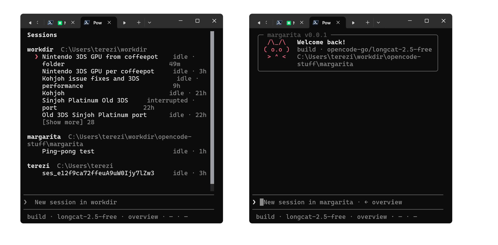

# margarita

```
 /\_/\
( o.o )   an alternative frontend for opencode
 > ^ <
```



**margarita** (`marg`) is a terminal frontend for the [OpenCode](https://opencode.ai) v2 server. it makes opencode feel more like claude or codex.

## Getting started

### What you need

- [Bun](https://bun.sh) **1.4.4** (see `.bun-version`)
- A running **OpenCode v2.3** service. margarita finds the one registered on your machine and connects to it **read-only**: it never starts, stops or reconfigures your service (unless you pass `--start-server` and none is registered).

### Option A: run from source

```sh
git clone https://github.com/estyseesghosts/margarita.git
cd margarita
bun install
bun run start            # same as `marg`
bun run start "fix the flaky test"
```

Want a real `marg` command? `bun link` registers it straight from source.

### Option B: build one self-contained executable

```sh
bun install
bun run build                  # → dist/marg.exe  (dist/marg on macOS and Linux)
bun run build bun-linux-x64    # cross-compile for another target
```

The result bundles the Bun runtime and OpenTUI's native library, so you can copy it anywhere on your `PATH`
(for example `%USERPROFILE%\.local\bin` on Windows or `~/.local/bin` elsewhere). More in [ADR-0006](adr/0006-packaging.md).

## Using `marg`

```sh
marg                                  # new session in this directory
marg "fix the flaky test"             # ...starting with a prompt
marg --continue                       # pick up the latest session here
marg --resume                         # open the session overview
marg --resume ses_123                 # jump to an exact session
marg -p -m opencode/longcat-2.5-free "summarize README.md"   # print mode (no TUI)
marg --help
```

Print mode is always explicit: giving a prompt never silently turns it on.

### Keys

| Key | Does |
| --- | --- |
| `Left` (empty prompt) | Open the overview |
| `Shift+Tab` | Cycle agents (`build` ↔ `plan`) |
| `Alt+P` / `F2` | Pick a model / use the recent one |
| `Ctrl+O` | Toggle detailed transcript |
| `Ctrl+R` | Search prompt history |
| `Ctrl+S` | Stash the current draft |
| `Ctrl+G` | Edit the prompt in `$EDITOR` |
| `Ctrl+J` / `Alt+Enter` | Newline / steer the running agent |
| `Ctrl+T` | Goal and task checklist |
| `Ctrl+B` | Move running tools to the background |
| `Ctrl+C` | Interrupt, clear, then exit |
| `F1` | Help |

Everything is a single key press. There are no chords. Rebind any of them in the config below.

### Slash commands

`/goal <title>` · `/criteria a; b` · `/plan step one; step two` · `/plan propose` · `/plan adopt` · `/sync on|off` ·
`/rename` · `/fork` · `/revert` · `/diff [turn]` · `/export [file]`

Plans and goals are local (under margarita's state directory) until you run `/sync on`, which leaves a short note for the agent.

### Config

`%LOCALAPPDATA%\margarita\config.jsonc` on Windows, or your XDG config directory elsewhere:

```jsonc
{
  "agents": { "default": "build", "cycle": ["build", "plan"] },
  "input": { "enterWhileRunning": "queue" },       // or "steer"
  "keys": { "tasks.toggle": "alt+t" },              // single keys only; F1 lists action IDs
  "ui": { "theme": "dark", "animation": true, "ascii": false }  // dark | light | high-contrast
}
```

Environment knobs: `NO_COLOR`, `MARGARITA_NO_ANIMATION=1`, `MARGARITA_ASCII=1`, and `MARGARITA_SERVER_PASSWORD` (for `--server`).

## Development

```sh
bun run verify     # format check + oxlint (type-aware) + typecheck + tests
```

- `MARGARITA_LIVE=1 bun test test/live-smoke.test.tsx` runs a read-only check against your running service.
- Code layout: `src/domain` (pure logic) · `src/adapter` (OpenCode client and events) · `src/app` (controller, keys) · `src/ui` (OpenTUI + Solid) · `src/cli` (args, print mode).
- Code style lives in the TypeScript guide used across this project: Bun, strict TS, small modules.

### Design docs

The product spec and decisions live in [`docs/`](docs/) (start with [01-product-contract](docs/01-product-contract.md)),
[`adr/`](adr/) and [`checklists/`](checklists/). The upstream API notes are in
[02-upstream-source-map](docs/02-upstream-source-map.md); check them whenever OpenCode changes versions.

## Status

Early days: version **0.0.1**. It works against OpenCode v2.3.0, and some terminals (Windows Terminal, Ghostty, tmux)
still want a manual look-over; see [checklists/release-candidate.md](checklists/release-candidate.md).
